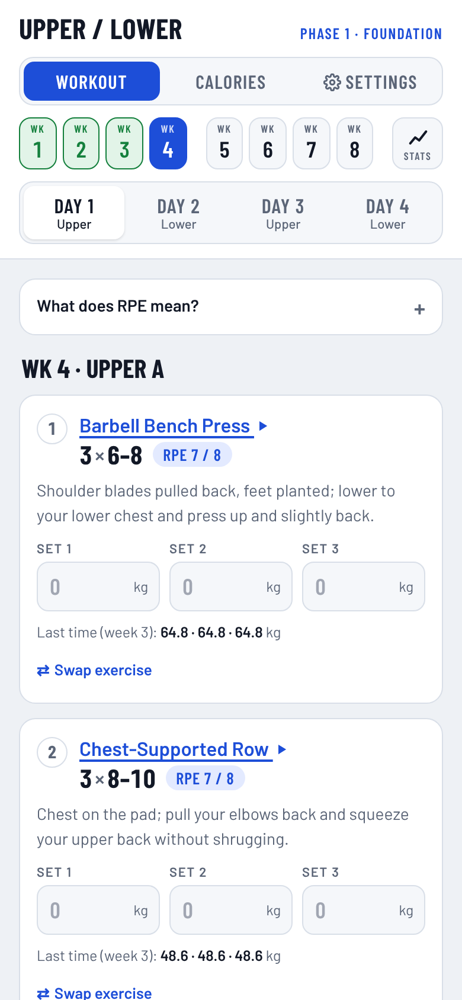

# Lift Ledger

**A workout log and calorie calculator that runs in your browser, installs to your phone's home screen, and works offline. No account, no tracking: your data stays on your device.**

[**Open the app →**](https://zain005.github.io/lift-ledger/)

[](https://github.com/zain005/lift-ledger/actions/workflows/tests.yml)

[](LICENSE)

<p>
  
  
  
</p>

<sub>Screenshots use made-up demo data.</sub>

## Contents

- [Features](#features)
- [Install on your phone](#install-on-your-phone)
- [Built-in programs](#built-in-programs)
- [Your own programs](#your-own-programs)
- [Your data and privacy](#your-data-and-privacy)
- [How the calorie numbers work](#how-the-calorie-numbers-work)
- [Run it locally](#run-it-locally)
- [Development](#development)
- [Sources](#sources)
- [Credits and license](#credits-and-license)

## Features

**Workout log**
- One box per set, with target reps and effort (RPE) for every exercise.
- "Last time" shows what you lifted the week before, so you know what to beat.
- Mark a day done when you finish:
  - Done days turn green.
  - A skipped day turns red once you complete a later one.
  - A red dot flags done days with empty sets.
- The app opens on your next session, or on the day that still needs weights.
- Swap any exercise for an alternative; the swap applies to that week only.

**Progress**
- Sessions completed and missed, shown as a week-by-week grid.
- Weekly training volume chart.
- Strength trend for every exercise, from first logged week to latest.

**Calorie calculator**
- BMR and maintenance from your details and weekly routine (training, cardio and rest days).
- Build your usual day of eating from a food list to see where you stand, from deficit to surplus.
- A what-if calculator for any single day, including extra food or activity.

**Settings**
- Switch between programs; each keeps its own log.
- kg or lb.
- Show or hide demo links, exercise tips, last-time weights, the RPE explainer and the Calories tab.

## Install on your phone

Open **[zain005.github.io/lift-ledger](https://zain005.github.io/lift-ledger/)**, then:

- **iPhone (Safari):** Share → **Add to Home Screen**.
- **Android (Chrome):** menu (⋮) → **Install app** or **Add to Home screen**.

It opens full-screen like an app and works offline after the first visit.

## Built-in programs

Three 8-week programs, written for this project. Each has two phases:
- **Weeks 1–4, Foundation:** moderate effort while you learn the movements.
- **Weeks 5–8, Build:** each set closer to failure.

The exercises stay the same throughout, which makes progress easy to track.

| Program | Days / week | Sessions | Hard sets per session |
|---|---|---|---|
| Full Body | 3 | Full Body A, B, C | 15–17 |
| Upper / Lower | 4 | Upper A, Lower A, Upper B, Lower B | 16–18 |
| Push Pull Legs | 6 | Pull, Push, Legs × 2 | 14–17 |

**Effort targets** are written as two numbers, for example **7–8 / 9**:
- The first number is the RPE for your early sets.
- The second is for your last set.

RPE 10 means no reps left in the tank; RPE 8 means two left.

**Reps** are ranges. When every set reaches the top of the range, add weight next time.

The design follows common evidence-based guidelines:
- About 6–12 hard sets per muscle per week, more on the 4- and 6-day programs.
- Effort measured by reps in reserve.
- Exercises that train muscles through a long range of motion, such as seated leg curls and overhead triceps extensions.

See [Sources](#sources). The programs are general guidance, not personal coaching. Check with a professional if you have an injury or health condition.

## Your own programs

Programs are plain JSON files:
1. Copy one from [`programs/`](programs) and edit it.
2. Import it from **Settings → Import a program**.

The format, including phases, rep ranges, RPE by exercise type, alternatives and demo links, is documented in **[docs/program-format.md](docs/program-format.md)**.

Imported programs stay on your device. Please only add programs to this repository that you wrote or have the right to share.

## Your data and privacy

- Everything is saved in your browser's local storage, on your device. Nothing is sent to a server, and the app makes no requests to other sites; the fonts are bundled.
- **Settings → Your data** lets you:
  - **Export a backup (.json):** everything, to restore later or on another device.
  - **Export sets (.csv):** one row per logged set, ready for Excel, Google Sheets, Python or Power BI.
  - **Restore a backup**, or **erase all data**.
- Clearing your browser's site data deletes your logs, so export a backup now and then.

## How the calorie numbers work

| Part | Method |
|---|---|
| BMR (energy at rest) | Mifflin-St Jeor equation. If you enter a body fat %, it's averaged with Katch-McArdle, which uses lean mass. |
| Daily life | BMR × an activity multiplier (1.2–1.5), which also covers digestion. |
| Treadmill walking | ACSM metabolic equation for walking, from speed, incline and body weight, counting only energy above rest. It assumes you don't hold the handrails. |
| Weight training | MET values for resistance training (3.5 moderate, 5.0 vigorous), minus the resting MET. |
| Steps (what-if) | An estimate of about 0.5 kcal per kg per km, using a stride length of 41.5% of height. |
| Week average | Weighted by how many training, cardio and rest days you have. |
| Weight change | About 7,700 kcal per kg of body fat. Real change differs, especially early on, because of water and glycogen. |
| Foods | Typical values per 100 g, rounded from public nutrition tables. Your labels may differ. |

Expect around ±10%. If your weight trend over 3–4 weeks doesn't match, adjust **Daily life** until it does. This is an estimate, not medical or nutrition advice.

## Run it locally

No build step and no dependencies. Serve the folder with any static web server:

```sh
git clone https://github.com/zain005/lift-ledger.git
cd lift-ledger
python3 -m http.server 4173
# open http://localhost:4173
```

Opening `index.html` straight from your files won't load the programs, because browsers block that.

## Development

**Built with** plain HTML, CSS and JavaScript. It has no framework, no build tools and no runtime dependencies.
- **Charts** are inline SVG drawn by the app itself.
- **Offline support** comes from a service worker and a web app manifest, so it can be installed as a PWA.
- **Tests** use [Playwright](https://playwright.dev/).
- **CI** runs on GitHub Actions, and the site is hosted on GitHub Pages.

```sh
npm install
npx playwright install chromium
npm test
```

The tests drive the app in a phone-sized browser. They check:
- logging and saving
- missed-session detection
- last-week weights
- swaps
- program switching
- program import
- CSV and backup export and restore
- settings
- the calorie calculator
- that the page makes no outside requests

They run on every push and pull request.

```
index.html               page markup
css/app.css              styles
js/app.js                workout log, programs, settings, export/import
js/calories.js           calorie calculator
programs/*.json          built-in programs
docs/                    program format and screenshots
sw.js                    offline cache (bump VERSION on each release)
manifest.webmanifest     install metadata
icons/, fonts/           app icons and bundled fonts
tests/                   Playwright tests
```

## Sources

**Energy expenditure**
- Mifflin MD, St Jeor ST, Hill LA, Scott BJ, Daugherty SA, Koh YO. A new predictive equation for resting energy expenditure in healthy individuals. *Am J Clin Nutr.* 1990;51(2):241–247. [doi:10.1093/ajcn/51.2.241](https://doi.org/10.1093/ajcn/51.2.241)
- McArdle WD, Katch FI, Katch VL. *Exercise Physiology: Nutrition, Energy, and Human Performance.* Lippincott Williams & Wilkins (Katch-McArdle equation).
- American College of Sports Medicine. *ACSM's Guidelines for Exercise Testing and Prescription*, metabolic equations for walking.
- Ainsworth BE, et al. 2011 Compendium of Physical Activities: a second update of codes and MET values. *Med Sci Sports Exerc.* 2011;43(8):1575–1581. [doi:10.1249/MSS.0b013e31821ece12](https://doi.org/10.1249/MSS.0b013e31821ece12)
- Hall KD. What is the required energy deficit per unit weight loss? *Int J Obes.* 2008;32(3):573–576. [doi:10.1038/sj.ijo.0803720](https://doi.org/10.1038/sj.ijo.0803720)
- U.S. Department of Agriculture. [FoodData Central](https://fdc.nal.usda.gov/) (typical food values).

**Training**
- Schoenfeld BJ, Ogborn D, Krieger JW. Dose-response relationship between weekly resistance training volume and increases in muscle mass: a systematic review and meta-analysis. *J Sports Sci.* 2017;35(11):1073–1082. [doi:10.1080/02640414.2016.1210197](https://doi.org/10.1080/02640414.2016.1210197)
- Zourdos MC, et al. Novel resistance training–specific rating of perceived exertion scale measuring repetitions in reserve. *J Strength Cond Res.* 2016;30(1):267–275. [doi:10.1519/JSC.0000000000001049](https://doi.org/10.1519/JSC.0000000000001049)
- Maeo S, et al. Greater hamstrings muscle hypertrophy but similar damage protection after training at long versus short muscle lengths. *Med Sci Sports Exerc.* 2021;53(4):825–837. [PubMed 33009197](https://pubmed.ncbi.nlm.nih.gov/33009197/)
- Maeo S, et al. Triceps brachii hypertrophy is substantially greater after elbow extension training performed in the overhead versus neutral arm position. *Eur J Sport Sci.* 2023;23(7):1240–1250. [doi:10.1080/17461391.2022.2100279](https://doi.org/10.1080/17461391.2022.2100279)

## Credits and license

- Created by [Zain Ali](https://github.com/zain005).
- Code: [MIT License](LICENSE).
- Fonts: [Barlow and Barlow Condensed](https://github.com/jpt/barlow) by The Barlow Project Authors, under the [SIL Open Font License 1.1](fonts/OFL.txt).
- Lift Ledger is a personal project and isn't affiliated with any coach, gym, program or equipment maker.
